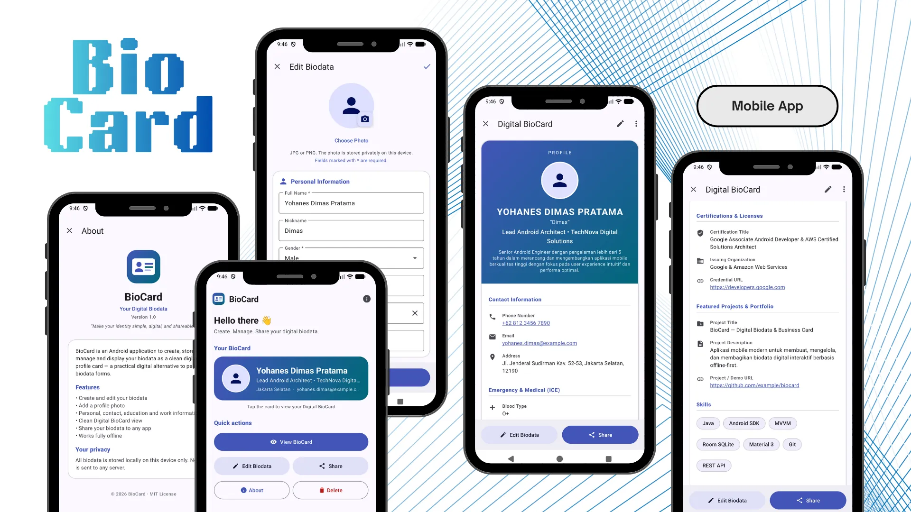
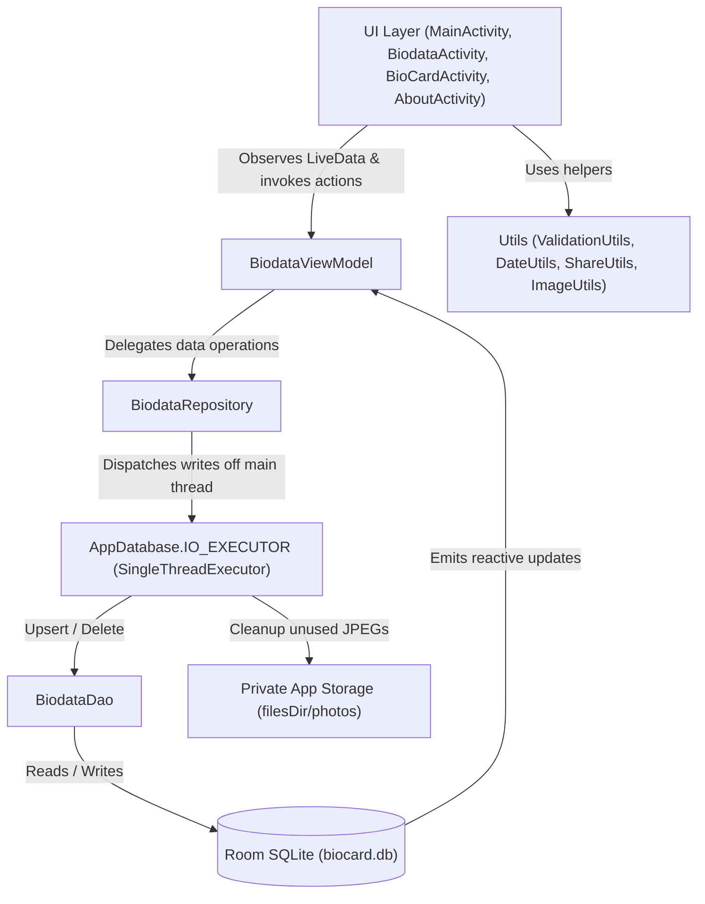
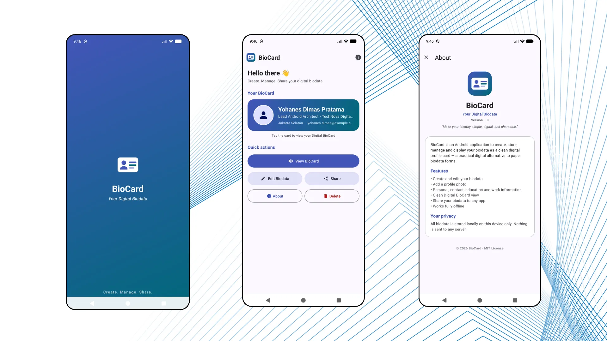
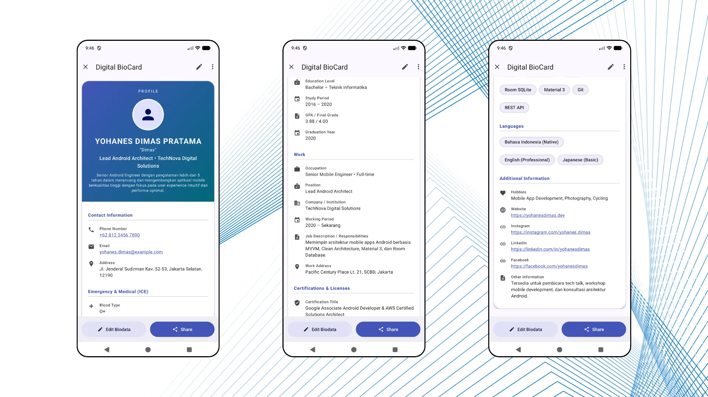
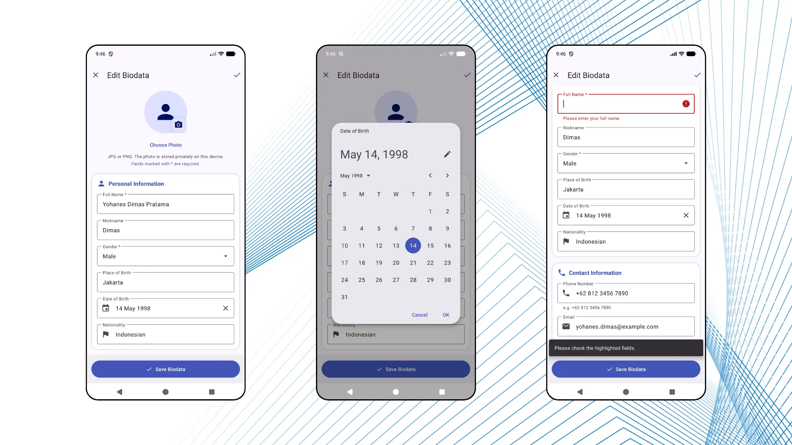

# BioCard - Digital Biodata




## Project Overview

BioCard is a native Android mobile application designed to replace paper biodata forms and scattered profile notes with a clean, structured digital identity card. It enables users to create, store, edit, view, and share comprehensive personal, contact, emergency medical (ICE), education, work history, certification, project, skill, and social profile details from a single offline-first mobile workspace. All data and profile photos are persisted locally on the device without requiring user accounts, network connectivity, or external servers.

## Key Features

- **Offline-First Single-Profile Storage**: Stores all biodata fields locally in an on-device Room SQLite database (`biocard.db`) with cloud backup and device transfer excluded via `data_extraction_rules.xml`.
- **Comprehensive Structured Biodata Editor**: Captures Personal Information, Contact Information, Emergency & Medical (ICE) details, Education, Work Experience, Certifications & Licenses, Featured Projects & Portfolio, Skills, Languages, Hobbies, Social Links, and Biography.
- **Permissionless Profile Photo Management**: Uses Android's system Photo Picker (`PickVisualMedia`) to import photos without storage permissions, automatically applying EXIF rotation correction, downscaling to 1024 px max dimension, JPEG compression, and orphan file cleanup.
- **Reactive Digital BioCard View**: Displays a gradient profile header and dynamically hides empty sections while auto-linking phone numbers, email addresses, and web URLs via `Linkify`, plus Material `ChipGroup` tags for skills and languages.
- **Form Validation & Date Picker**: Enforces required fields (`Full Name`, `Gender`) and validates email, phone (6–15 digits), graduation year, and URLs with inline `TextInputLayout` error clearing and a backward-constrained `MaterialDatePicker`.
- **One-Tap Plain-Text Sharing**: Formats all populated fields into a clean plain-text summary via `ShareUtils` and launches the Android system share chooser (`Intent.ACTION_SEND`).
- **Edge-to-Edge Material 3 UI**: Implements edge-to-edge window insets across all activities (`BaseActivity`), animated splash transition, and a confirmation dialog before deleting stored biodata.

## Supported Platforms

| Platform | Operating System | Minimum Version | Support / Test Status |
| :--- | :--- | :--- | :--- |
| Android Mobile | Android (API 26–36) | Android 8.0 Oreo (API 26) | Configured target (`minSdk 26`, `targetSdk 36`, `compileSdk 36`); debug and release APKs built via Gradle; unit tests cover `utils` package |

## Tech Stack

| Category | Technology | Purpose |
| :--- | :--- | :--- |
| Programming Language | Java | Core application logic, UI activities, ViewModel, Room entities, and unit tests |
| Platform SDK | Android SDK | Native Android activity lifecycle, intents, bitmap decoding, and system Photo Picker |
| Architecture | AndroidX ViewModel & LiveData | Lifecycle-aware MVVM state observation between database and UI |
| Local Database | Room Persistence Library (SQLite) | Structured local persistence via `AppDatabase`, `BiodataDao`, and `Biodata` entity |
| UI Toolkit | Material Components for Android (Material 3) | Cards, outlined inputs, `MaterialDatePicker`, `ChipGroup`, `Snackbar`, and dialogs |
| View Layer | Android ViewBinding & ConstraintLayout | Type-safe view references and responsive edge-to-edge XML layouts |
| Media Processing | Android Graphics & `ExifInterface` | EXIF orientation correction, bitmap downscaling, and private JPEG photo storage |
| Build System | Gradle & Android Gradle Plugin | Dependency resolution, ProGuard/R8 shrinking, and APK packaging |
| Unit Testing | JUnit 4 | Unit tests for `DateUtils`, `ShareUtils`, and `ValidationUtils` |

## Application Architecture

BioCard follows a single-module Android MVVM architecture organized into `ui`, `viewmodel`, `data`, and `utils` packages. `SplashActivity`, `MainActivity`, `BiodataActivity`, `BioCardActivity`, and `AboutActivity` extend `BaseActivity` (for edge-to-edge insets and shared delete confirmation) and observe `LiveData<Biodata>` exposed by `BiodataViewModel`. `BiodataRepository` coordinates read observations from `BiodataDao` and offloads all database writes and private photo cleanup to the single-threaded `AppDatabase.IO_EXECUTOR`, posting completion callbacks back to the main thread.



## Screenshots / Preview

### 1. Splash Screen, Home Dashboard & About Overview

From left to right, the application launches with an animated gradient splash screen (`SplashActivity`), transitions into the Home dashboard (`MainActivity`) featuring the interactive BioCard summary header and Quick Actions grid (`View BioCard`, `Edit Biodata`, `Share`, `About`, `Delete`), and provides an About screen (`AboutActivity`) summarizing version metadata, local-only privacy guarantees, and MIT licensing.

### 2. Digital BioCard Profile & Sectioned Card View

The `BioCardActivity` renders stored biodata into a scrollable digital profile card starting with a gradient header, contact details, and Emergency & Medical (ICE) info (left), continuing through Education, Work Experience, and Certifications (center), and concluding with Skill/Language chips and Additional Information above persistent `Edit Biodata` and `Share` action buttons (right).

### 3. Biodata Editor, Date Picker & Inline Validation

`BiodataActivity` provides a sectioned input form with private photo selection and Personal Information fields (left), an integrated `MaterialDatePicker` restricted to past dates for Date of Birth entry (center), and real-time inline `TextInputLayout` error highlighting paired with a bottom `Snackbar` prompt when required or formatted fields fail validation (right).

## Prerequisites

- **End Users**: Android smartphone or tablet running Android 8.0 Oreo (API level 26) or higher.
- **Developers**:
  - Java Development Kit (JDK) 17
  - Android SDK with Platform API 36 (`compileSdk 36`)
  - Android Studio (recommended) or Gradle Wrapper (`9.8.1` bundled via `gradlew` / `gradlew.bat`)

## Installation & Setup

1. Clone the repository to your local machine:

   ```bash
   git clone https://github.com/weztcy/BioCard-Digital-Biodata.git
   cd BioCard-Digital-Biodata
   ```

2. Ensure Android SDK Platform 36 is installed and configured in `local.properties` (for example, `sdk.dir=/path/to/Android/Sdk`), or open the project directly in Android Studio to let it configure the SDK automatically.

3. Build the debug APK using the bundled Gradle wrapper:

   ```bash
   # Linux / macOS
   ./gradlew assembleDebug

   # Windows PowerShell / CMD
   .\gradlew.bat assembleDebug
   ```

4. Install and launch on a connected Android device or emulator:

   ```bash
   ./gradlew installDebug
   ```

## Application Configuration

No external API keys, environment files, or backend endpoints are required to run BioCard. Build-level and local privacy settings are defined directly in [app/build.gradle](app/build.gradle), [app/src/main/AndroidManifest.xml](app/src/main/AndroidManifest.xml), and [app/src/main/res/xml/data_extraction_rules.xml](app/src/main/res/xml/data_extraction_rules.xml).

| Configuration | Description | Default / Example |
| :--- | :--- | :--- |
| `applicationId` | Android package identifier for the application | `com.example.biocard` |
| `minSdk` / `targetSdk` | Minimum supported and target Android API levels | `26` (Android 8.0) / `36` |
| `DATABASE_NAME` | Local Room SQLite database filename in `AppDatabase` | `biocard.db` (schema version `2`) |
| `PHOTO_DIR` / `MAX_PHOTO_SIZE` | Private photo storage subdirectory and max bitmap pixel dimension | `photos` / `1024` px (JPEG quality `90`) |
| `allowBackup` & `dataExtractionRules` | Excludes database, files, and preferences from cloud backup and device transfer | `false` / `@xml/data_extraction_rules` |
| `release.signingConfig` | Release APK signing configuration (currently uses debug key for local testing) | `signingConfigs.debug` (replace before store publishing) |

## Database & Local Storage

BioCard persists all user data strictly on-device using Room over SQLite and app-private file storage. The `biodata` table holds a single row keyed by `Biodata.SINGLE_ID = 1`, while profile photos selected through the system Photo Picker are copied into `context.getFilesDir()/photos` and cleaned up automatically whenever a photo is replaced or the profile is deleted.

| Storage Mechanism | Purpose | Details |
| :--- | :--- | :--- |
| Room SQLite (`biocard.db`) | Structured persistence of all biodata fields | Single entity `Biodata` (`tableName = "biodata"`), accessed via `BiodataDao` (`observeBiodata()`, `upsert()`, `deleteAll()`) |
| `AppDatabase.IO_EXECUTOR` | Ordered background disk I/O | `Executors.newSingleThreadExecutor()` handles all Room writes and file cleanup off the UI thread |
| Internal App Files (`filesDir/photos`) | Private profile photo storage | Stores downscaled, EXIF-corrected JPEG copies (`photo_<timestamp>.jpg`) isolated from external apps |
| `data_extraction_rules.xml` | Privacy enforcement on backup/transfer | Excludes `root`, `file`, `database`, `sharedpref`, and `external` domains from cloud backup and device transfer |

```java
instance = Room.databaseBuilder(context.getApplicationContext(),
                AppDatabase.class, "biocard.db")
        .fallbackToDestructiveMigration()
        .build();
```

## Testing

BioCard includes JUnit 4 unit tests under `app/src/test/java/com/example/biocard/utils/` covering date formatting/UTC conversions, share-text formatting, and form field validation rules.

- `DateUtilsTest`: Verifies ISO-8601 parsing, display formatting (`dd MMMM yyyy`), and `MaterialDatePicker` UTC millisecond round-trips.
- `ShareUtilsTest`: Verifies string joining, education formatting, and plain-text output generation across minimal, full, and enhanced (ICE, certifications, projects, languages) biodata profiles.
- `ValidationUtilsTest`: Verifies blank checks, email regex, E.164-length phone validation (6–15 digits), graduation year bounds, and website URL validation.

```bash
# Run local JVM unit tests
./gradlew testDebugUnitTest
```

## Build & Packaging

Release builds enable code minification (`minifyEnabled true`) and resource shrinking (`shrinkResources true`) using [app/proguard-rules.pro](app/proguard-rules.pro), producing standalone APK artifacts under `app/build/outputs/apk/`.

1. Clean previous build artifacts and assemble the debug APK (`app/build/outputs/apk/debug/app-debug.apk`):

   ```bash
   ./gradlew clean assembleDebug
   ```

2. Assemble the minified release APK (`app/build/outputs/apk/release/app-release.apk`):

   ```bash
   ./gradlew assembleRelease
   ```

3. Before distributing publicly, configure a dedicated release keystore in `app/build.gradle` to replace the default `signingConfigs.debug` fallback.

## Usage

After installing and launching BioCard on an Android device or emulator, users can manage their digital profile completely offline:

1. Wait briefly through the animated splash screen to reach the **Home** dashboard (`MainActivity`).
2. When no profile exists yet, tap **Create Biodata** to open the editor form (`BiodataActivity`). Optionally tap **About** to review privacy and version information.
3. Fill in the required fields (**Full Name** and **Gender**), optionally choose a profile photo via the system Photo Picker, select a birth date with the calendar picker, and complete any desired Contact, ICE Medical, Education, Work, Certification, Project, Skill, Language, or Social fields.
4. Tap **Save Biodata** (or the toolbar checkmark) to validate inputs and persist the card locally.
5. Inspect the rendered **Digital BioCard** (`BioCardActivity`), tap phone/email/URL links directly, or tap **Share** to export a formatted plain-text biodata card through any installed messaging or email app.
6. Return to **Home** or use the toolbar actions to edit existing details or delete all stored biodata after confirming the warning dialog.

## Contributing

Contributions to improve BioCard are welcome through standard GitHub pull requests:

1. Fork the repository.
2. Create a feature or bugfix branch from `main` (for example, `git checkout -b feat/your-feature`).
3. Make your changes while keeping offline-first privacy and existing code conventions intact.
4. Validate your changes by building the project and running `./gradlew testDebugUnitTest`.
5. Commit and push your branch to your fork.
6. Open a pull request with a clear explanation of the changes and verification performed.

## License

This project is licensed under the MIT License.
See the [LICENSE](LICENSE) file for details.

## Author & Contact

**Yohanes Dimas Pratama**

- GitHub: [github.com/weztcy](https://github.com/weztcy)
- Portfolio: [yohanesdimas.com](https://yohanesdimas.com)
- LinkedIn: [linkedin.com/in/yohanes-dimas](https://www.linkedin.com/in/yohanes-dimas)
